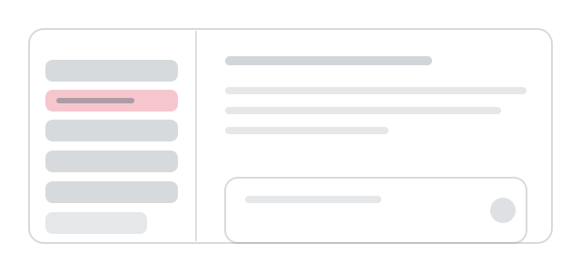

# dsh-sidebar-selected-tint

在 DeepSeekRuntime（DSH）左侧边栏里，把**被选中的会话行**从官方默认的灰色高亮换成**浅红色**。

A DSH client plugin that tints the selected session row in the sidebar light red instead of the default gray highlight.



## 功能

- **影响范围**：左侧边栏的会话行，选中态背景改为浅红色。
- **生效位置**：会话列表，以及侧边栏的会话搜索结果列表。
- **主题自适应**：颜色取自主题里的红色令牌（`--dsw-alias-state-error-primary`）与透明混合，浅色主题是浅红、深色主题是暗红，无需区分主题。
- **行为不变**：行的点击、右键菜单、置顶、归档、拖拽排序都不受影响，只改背景色。
- **可一键还原**：在「插件」里停用即恢复官方默认样式。

## 安装

三种方式，任选其一。

**1) 本地目录（开发时最方便）**

「插件」›「添加插件」› 选择本仓库目录。

**2) 打包产物**

```bash
npm pack          # 生成 dsh-sidebar-selected-tint-1.0.0.tgz
```

「插件」›「添加插件」› 选择该 `.tgz`。

**3) 让 Agent 安装**

```
plugin_manager  action: install_bundle
                target: file:/绝对路径/dsh-sidebar-selected-tint-1.0.0.tgz
```

安装后一般由 client-hmr 直接生效；若侧边栏还没变色，刷新一次窗口。

## 实现

官方侧边栏的会话行由 `@deepseek-ai/dsh-client-ui-workspace` 渲染，它只对外暴露行内插槽
（`sidebar.session.row.leading` / `.trailing` / `.hover`），**没有**「整行背景」插槽，
因此覆盖选中态只能追加样式表。

官方原样式（来自该包构建产物）：

```css
.YDXeBa_sessionRow.YDXeBa_selected { background-color: var(--dsw-alias-interactive-bg-hover) }
```

`YDXeBa` 是 CSS Modules 的构建哈希前缀，会随版本变化；`_sessionRow` / `_selected`
这类语义后缀来自源码里的模块类名，跨版本稳定，所以用属性子串匹配：

```css
:root [class*="_sessionRow"][class*="_selected"],
:root [class*="_searchResultRow"][class*="_selected"] {
  background-color: rgba(226, 74, 96, 0.18);                                              /* 兜底 */
  background-color: color-mix(in srgb, var(--dsw-alias-state-error-primary, #e04257) 20%, transparent);
}
```

`:root` 额外提供一个伪类的权重（0,3,0），高于官方的 `.sessionRow.selected`（0,2,0），
因此不需要 `!important`。样式表由 `ctx.effect` 注入，插件卸载/停用时随清理函数移除。

完整代码见 [client.js](client.js)，约 60 行，无依赖、无构建步骤。

## 文件结构

| 文件 | 作用 |
|---|---|
| `client.js` | 全部功能：注入样式表（`window.__ModuleLoader__.load` 格式） |
| `index.js` | Host 侧空壳，让 bundle 拥有 Loader 条目并出现在「插件」列表 |
| `cordis.patch.yml` | bundle patch，插入一行 carrier 条目 |
| `package.json` | `dsh.bundle.patch` + `dsh.client`（`platform: web`、`immediately`） |
| `locale/*.json` | 插件页标题 / 说明（中英双语） |
| `icon.svg`、`docs/` | 图标与详情页配图 |

## 兼容性

- 在 **DSH 0.2.2-rc.5**（`@deepseek-ai/dsh-client-ui-workspace@0.2.2-rc.5`）上开发并核对选择器。
- 依赖官方会话行的 `_sessionRow` / `_selected` CSS Module 类名语义；若官方重命名这两个类名，
  需要同步更新 `client.js` 里的选择器。
- 只改选中态背景，不改变文字颜色、图标，也不影响其它插件注册的行内插槽。
- 若官方将来提供「整行」插槽，应改为插槽实现，无需再覆盖样式。

## 许可

[MIT](LICENSE)
